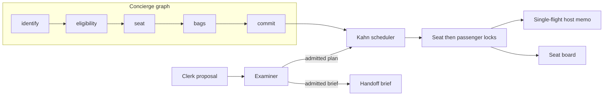

# Harborline

A departure-control laboratory. One fictional flight, HB418 from Bengaluru to Mangaluru, and the mechanisms I use when a passenger update has to be ordered, locked, and cheap to read.

This is original portfolio code. The passengers are synthetic. It is not Sabre source, not a copy of an internal system, and not a production departure-control suite. The production numbers on my résumé (throughput, savings, team size) belong to that work. What this repository proves is the invariants underneath those systems, with tests instead of a slide.

## The idea

A passenger change is an **intent**. It names the facts it reads and the facts it writes. It does not call the next procedure itself.

From that, four rules:

1. **Kahn orders the facts.** If a stamp reads `SEAT`, the seat intent runs first. Arrival order only breaks ties. A cycle fails the batch before anything is written. See [0002](docs/adr/0002-kahn-orders-facts.md).
2. **Locks are seat, then passenger, both sorted.** Two passengers can check in at once when they want different seats. They cannot both take 12C, and two updates cannot overlap on the same passenger. A flight-wide lock is the design I rejected. See [0003](docs/adr/0003-lock-seats-then-passengers.md).
3. **The host is read once per key.** Waiters share the in-flight call. A failure is not cached. Twenty check-ins on HB418 produce one seat-map read. See [0004](docs/adr/0004-one-host-read-per-key.md).
4. **The check-in graph owns the tools.** Identify, eligibility, seat, bags, commit. A node that tries to commit early throws, and the call does not happen. A decider that names a seat which was not offered does not get that seat repaired in secret. A cassette fails the run when a later change walks a different path. See [0005](docs/adr/0005-the-graph-owns-the-tools.md).
5. **The clerk proposes, and the examiner admits.** A model may name a party plan or a handoff brief. It gets one revision after a typed refusal. It cannot stamp a check-in, and a brief that smuggles a seat write is refused. The desk then takes every seat in an admitted party under one lock acquisition, or it takes none. See [0007](docs/adr/0007-the-clerk-proposes.md).

The ADRs are also a catalog. `Catalog` ranks them with TF-IDF so a question about a host stampede returns the memo decision, not whichever page mentions the word "host". See [0006](docs/adr/0006-query-the-decisions.md).



## What maps to the work I have actually done

| Experience | What this lab makes executable |
| --- | --- |
| Agentic check-in on a departure-control flow | `concierge/harborline/graph.py` — the journey is a graph with an allow-list, not a prompt that happens to have tools |
| Rule and configuration orchestration, dependency-ordered | `KahnScheduler` — fact edges, stable tie-break, cycle reported as the ids that could not run |
| High-throughput passenger updates and locking | `PassengerGate` — striped locks, disjoint work overlaps, same seat does not |
| A store that stops repeated host reads | `HostMemo` — TTL plus one in-flight future per key, failures left uncached |
| Keeping a regression attached to a changing flow | `Cassette` — replay is a failure when the tool payload drifts |
| A knowledge catalog for agents | `Catalog` over `docs/adr` — decisions only, ranked, no network |
| Where an agent may act on a known flow | `clerk/` — one revision against a typed refusal; the happy path stays on the graph |

## Run

Java 21 or newer, Maven, Python 3.11.

```bash
./demo
./demo-clerk
mvn -B -f orchestrator/pom.xml test
python3 -m unittest discover -s concierge/tests -v
PYTHONPATH=clerk:concierge python3 -m unittest discover -s clerk/tests -v
```

`./demo` is the walkthrough. The concierge checks in the HB418 roster, rejects a cassette replay that commits a different seat, and asks the ADR catalog three questions. The desk then checks in six passengers on virtual threads, prints the intent order, and shows that twenty-plus milliseconds of host latency still produce one seat-map read. Two passengers who both ask for 18C produce one receipt and one refusal.

`./demo-clerk` is the agent walkthrough. The party clerk names seat `1A`, the examiner refuses it, and the revision admits 12C beside 12A. The handoff clerk tries to hide a seat write inside Leela Das's document brief, and the revision is a brief the desk never sees. The saved run is [captures/clerk.txt](captures/clerk.txt).

## Layout

```
docs/adr/          decisions, which are also the catalog corpus
captures/          transcripts of the walkthroughs
roster/hb418.json  the only flight
orchestrator/      Java 21 desk: scheduler, gate, memo, party admission
concierge/         Python graph, cassette, catalog
clerk/             proposal, examiner, one revision
```

## What I deliberately left out

No model key, no claim of a transactions-per-second number measured on a laptop, no generated microservice fleet. A model adapter would implement `choose_seat` or `propose` and would still be unable to commit from the seat node or the clerk session. That constraint is the point.
